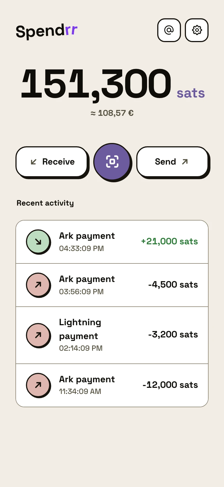
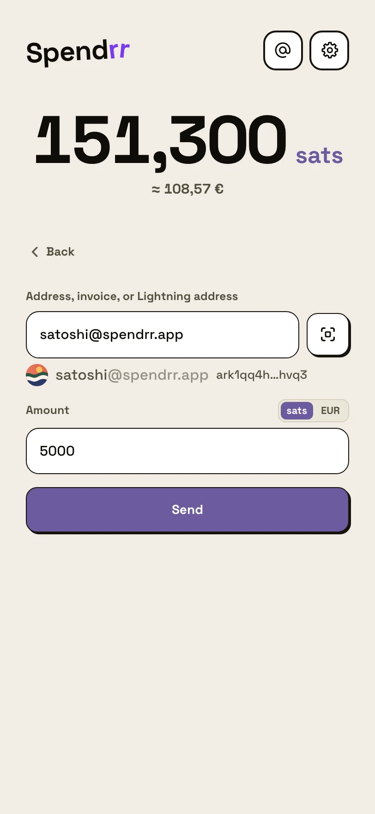
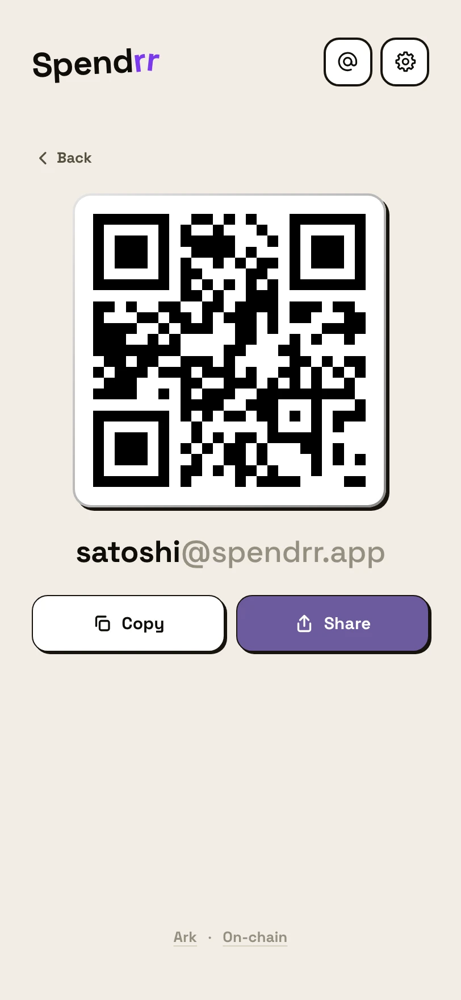

# Spendrr

A Bitcoin wallet for people who don't want to learn how Bitcoin works.
Self-custodial, instant and cheap payments, no jargon. Runs in the browser and installs as an app.

**[Open the wallet](https://spendrr.app)** · **[What is it?](https://spendrr.app/learn/en)**

<p>
  <picture>
    <source media="(prefers-color-scheme: dark)" srcset="public/learn-img/en/home-dark.webp">
    
  </picture>
  <picture>
    <source media="(prefers-color-scheme: dark)" srcset="public/learn-img/en/send-dark.webp">
    
  </picture>
  <picture>
    <source media="(prefers-color-scheme: dark)" srcset="public/learn-img/en/receive-dark.webp">
    
  </picture>
</p>

> [!WARNING]
> Real money on Bitcoin mainnet. No independent security audit yet. Keep only what you can afford to
> lose, and keep your seed phrase backed up.

## ⚡ What it does

- **Send to anything.** Paste or scan, the wallet works out the rest: Ark address, Lightning invoice,
  Lightning address, LNURL, on-chain address. Every send shows a confirmation screen. Larger amounts
  ask for the password again.
- **Receive** with a QR code. Push notification on incoming payments, even with the app closed.
- **Gift links.** Send bitcoin as a link. Unclaimed gifts can be taken back.
- **@names.** Pay `@alice` instead of an address. Profile page at `spendrr.app/@alice`, Lightning address
  `alice@spendrr.app`.
- **Tap to pay.** Tap two phones together to pay.
- **Point of sale.** A till for a tablet or computer, with a price list.
- **Encrypted cloud backup** of wallet state, on top of the seed phrase. The server only ever sees ciphertext.
- **Emergency exit.** Move funds to a regular Bitcoin address without the Ark server's cooperation.
- **Automatic coin refresh**, so Ark coins don't expire unnoticed.
- **Chat** (beta). Messages over Nostr that can carry a payment.
- Password plus optional fingerprint or Face ID unlock, auto-lock, shake to hide the balance, offline mode,
  light and dark themes, Czech and English.

Some of these are still in beta: turn them on with "Try the beta version" in Settings.

## 🔐 Why you can trust it

You shouldn't, blindly. Here is what you can check.

**Your keys stay with you.** The seed phrase is generated and stored on your device, encrypted with your
password (PBKDF2-SHA256, 600k iterations, AES-GCM). Decrypted, it exists only inside a dedicated Web Worker.
Spendrr's server never sees it and never holds funds.

**A malicious dependency can't phone home.** Both places that ever hold the seed run behind a network
allowlist ([`fetch-guard.js`](public/fetch-guard.js), [`walletWorkerGuard.ts`](src/lib/wallet/walletWorkerGuard.ts)),
and a strict Content Security Policy blocks third-party scripts.

**Spending rules are an allowlist.** Every wallet operation is classified in
[`walletSpendPolicy.ts`](src/lib/wallet/walletSpendPolicy.ts). Anything that moves money above a small
threshold needs the password, and so does every exit.

**The site runs the code in this repo.** The build is reproducible, so you can rebuild a tagged
release and compare every file spendrr.app serves with your build, byte for byte. Steps are in
[VERIFY.md](VERIFY.md). A public workflow ([`deploy-watch`](.github/workflows/deploy-watch.yml)) does the
same every hour, and a failed run is the alert.

This covers the app itself, not the code of the Cloudflare Worker that serves it.

## 🛠️ Run it locally

Needs Node.js. CI builds with Node 26.

```bash
npm ci
npm run dev -- --mode signet   # https://localhost:5173 on signet, test coins only
npm run dev                    # mainnet: real money
```

```bash
npm run build   # typecheck + production build
npm run lint
npm run test    # unit tests
npm run e2e     # end-to-end against a local regtest Ark server, see e2e/README.md
```

**How the code is organised**

| Path | What's there |
|---|---|
| `src/components` | Screens and sheets (React) |
| `src/lib/wallet` | The WASM bridge, the wallet worker, the spend policy |
| `src/lib/vault` | Seed encryption, password, passkeys |
| `src/lib/send` | Recognising and checking payment destinations |
| `src/lib/exit`, `backup`, `gift`, `names`, `bump`, `pos`, ... | One folder per feature |
| `worker` | Cloudflare Worker: push, @names, Lightning address, backup storage, price proxy |
| `tests`, `e2e` | Unit tests and regtest end-to-end tests |

Under the hood: React 19 and Vite, the [Ark protocol](https://second.tech) through the
[`@secondts/bark`](https://www.npmjs.com/package/@secondts/bark) WASM SDK, server `ark.second.tech`.

## 🏠 Running your own copy

Self-hosting isn't packaged yet. The app is a static build that talks to the Ark server directly.
The extras (push notifications, @names, Lightning address, cloud backup, price data) come from the Worker
in `worker/`, and [`wrangler.toml`](wrangler.toml) is the production config for spendrr.app. To run your
own, point its routes and bindings at your own Cloudflare account. The KV namespace ids in the file are
placeholders, and every secret the Worker reads (`env.*` in `worker/`) is set with `wrangler secret put`,
never stored in the repo.

A public copy must not be called Spendrr or use its logo (see [TRADEMARKS.md](TRADEMARKS.md)).

## 🤝 Contributing

Issues are welcome: bug reports, questions, and notes from reading the code. Pull requests are not
accepted for now. Releases are published as snapshots of the maintainers' tree, so a merged PR would
not keep its author. Say what you found and the fix goes into the next release.

## 🛡️ Security

Found a vulnerability? Don't open a public issue. Report it privately through
[GitHub's private vulnerability reporting](../../security/advisories/new). Scope and what to expect are in
[SECURITY.md](SECURITY.md).

## ⚠️ Known limitations

- The WASM SDK is ~7.7 MB (~4.3 MB gzipped), so the first load is slow on a poor connection.
- An Ark coin that is still partly off-chain when it expires is lost. Automatic refresh and expiry
  reminders exist to prevent that, but the risk comes with Ark itself.
- No independent security audit.

## 📄 License

Copyright (c) 2026 The Spendrr developers.

[AGPL-3.0-only](LICENSE). If you run a modified version as a service, you must offer its source to your
users. The Spendrr name and logo are not covered by the license.
Third-party notices: [`/third-party-licenses.txt`](https://spendrr.app/third-party-licenses.txt).
